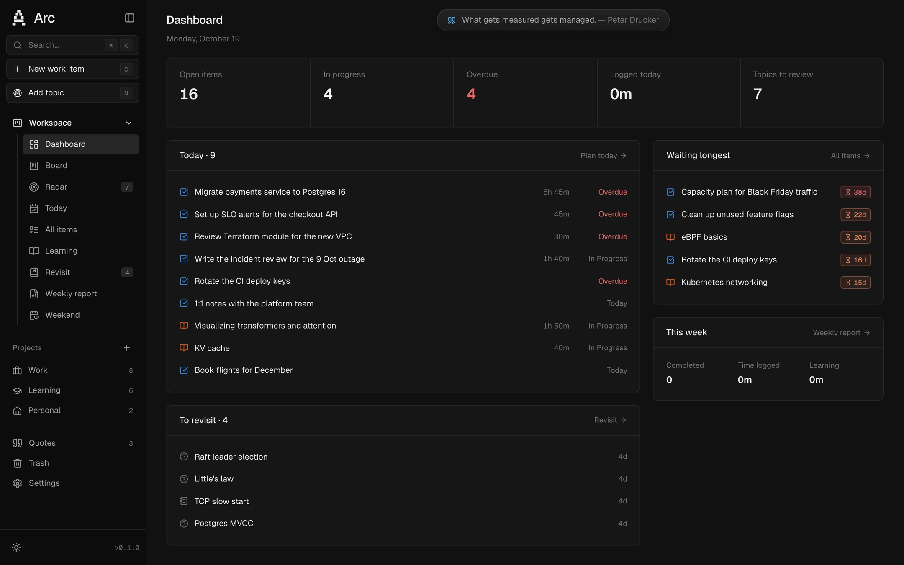
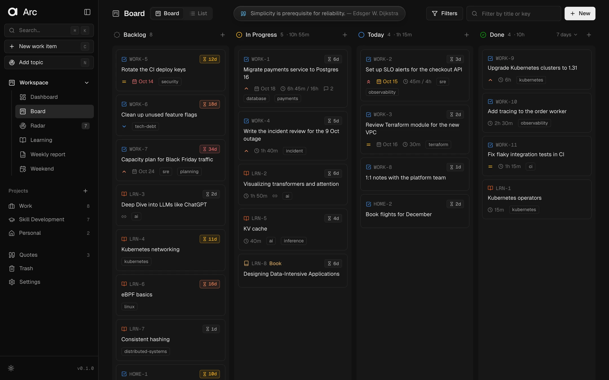
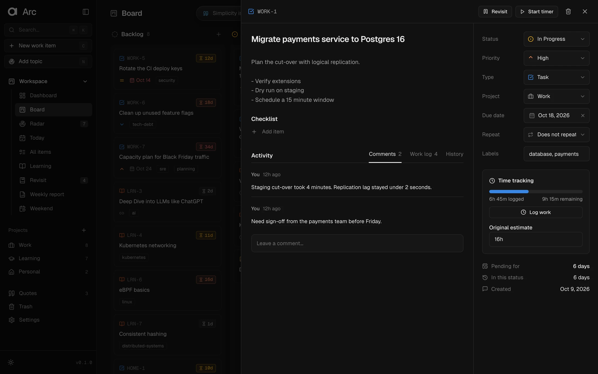
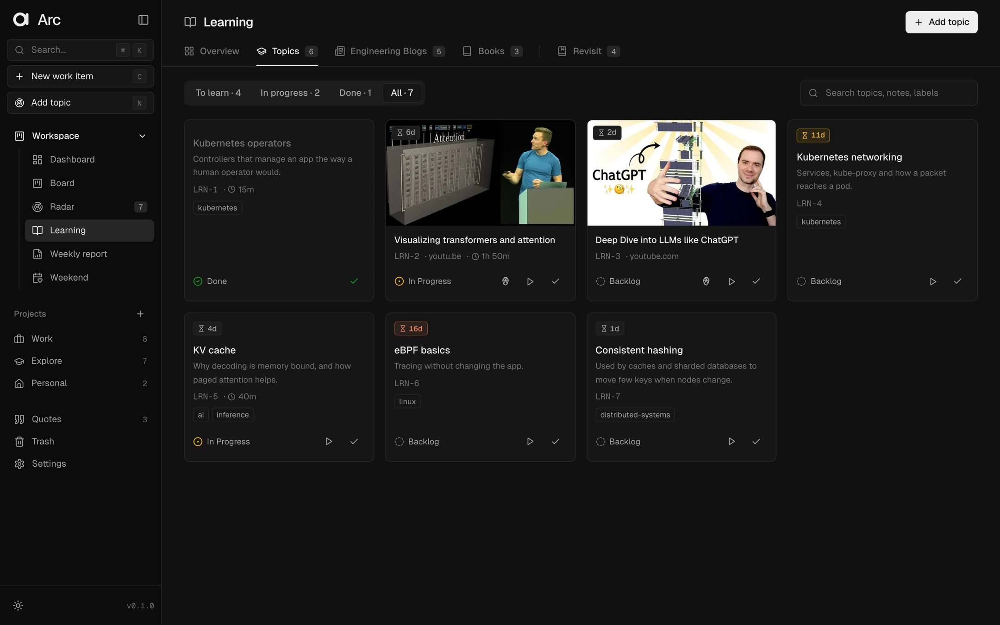
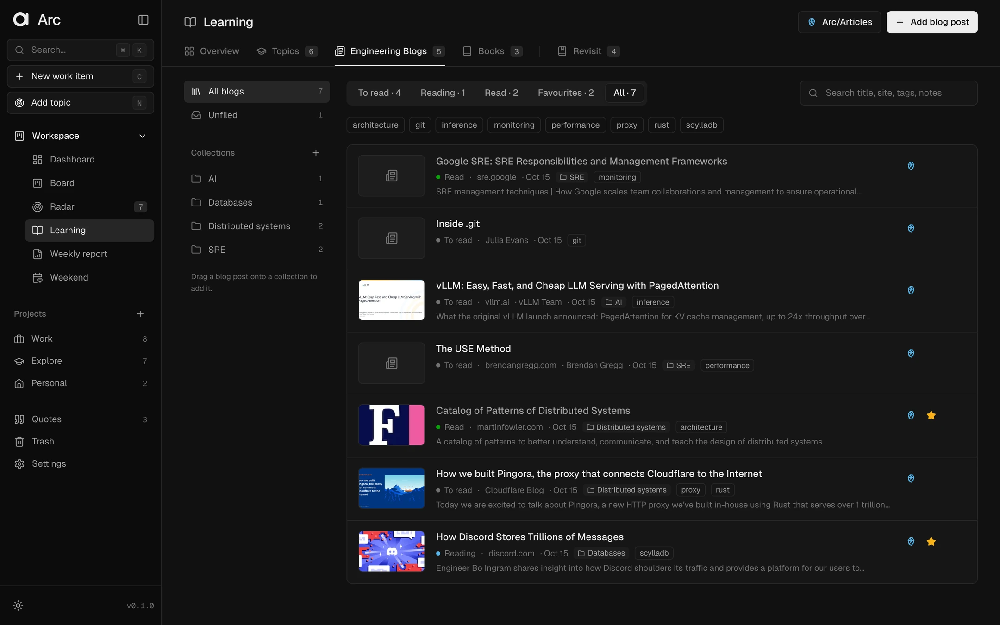
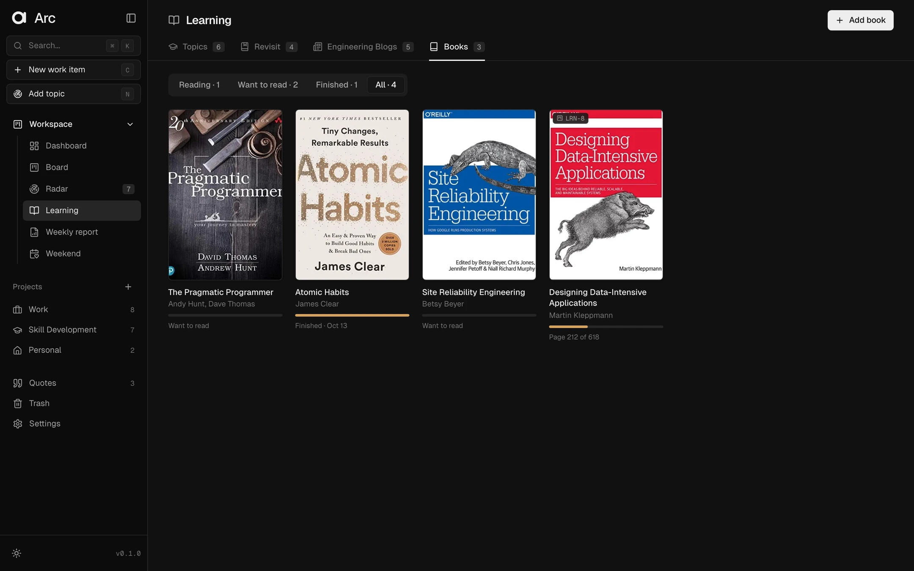
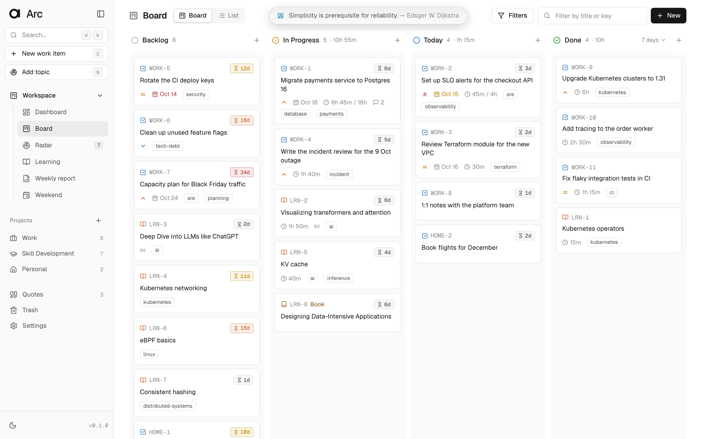
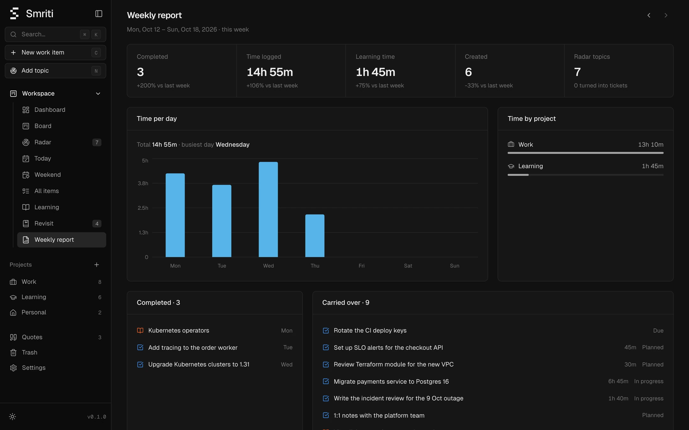
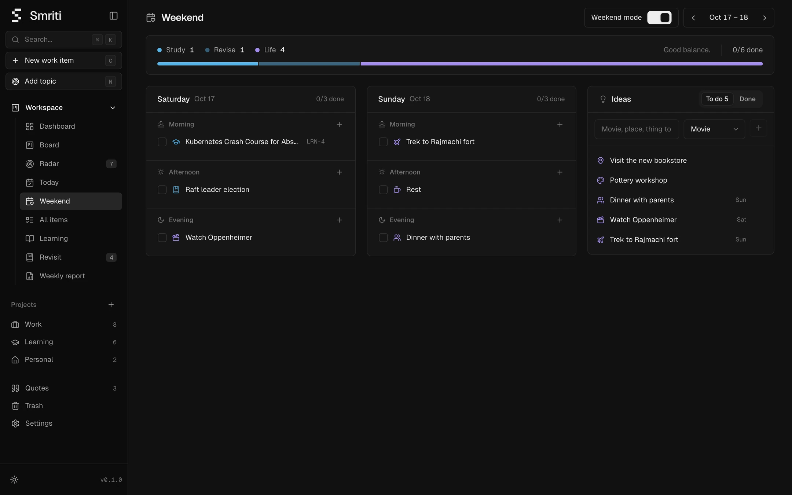

# Arc

Arc is a personal work and learning tracker. It runs on your computer in one Docker container and keeps everything in a SQLite file in this folder. Nothing leaves your machine.

Use it to plan your day, track time on tasks like in Jira, keep a list of things you heard about, and keep what you learned in front of you so you don't forget it.



## A quick tour

<table>
  <tr>
    <td width="50%" valign="top">
      <b>Board</b><br>
      <sub>Backlog, In Progress, Today and Done. Badges turn amber, orange and red as items wait.</sub><br><br>
      
    </td>
    <td width="50%" valign="top">
      <b>Item panel</b><br>
      <sub>Description, checklist, comments, Jira-style work log and time tracking.</sub><br><br>
      
    </td>
  </tr>
  <tr>
    <td width="50%" valign="top">
      <b>Learning: Topics</b><br>
      <sub>Things to study, with or without a video. Paste a link and the title fills in.</sub><br><br>
      
    </td>
    <td width="50%" valign="top">
      <b>Learning: Engineering Blogs</b><br>
      <sub>Blog posts in collections, with notes, saved as notes in Obsidian.</sub><br><br>
      
    </td>
  </tr>
  <tr>
    <td width="50%" valign="top">
      <b>Learning: Books</b><br>
      <sub>Covers from Open Library, reading progress, and a Book ticket on the board.</sub><br><br>
      
    </td>
    <td width="50%" valign="top">
      <b>Light theme</b><br>
      <sub>Every page works in dark and light.</sub><br><br>
      
    </td>
  </tr>
  <tr>
    <td width="50%" valign="top">
      <b>Weekly report</b><br>
      <sub>Time per day and project, what got done and what carried over.</sub><br><br>
      
    </td>
    <td width="50%" valign="top">
      <b>Weekend</b><br>
      <sub>Plan Saturday and Sunday with study, revision and life.</sub><br><br>
      
    </td>
  </tr>
</table>

<sub>Screenshots use demo data.</sub>

## Features

### Work

- **Board**: Kanban board with Backlog, In Progress, Today and Done, and a **Board / List** switch in its header. List is a sortable table of every item with filters. Drag cards between columns. The Done column shows items completed in the last 7 days by default; switch it to Today, 30 days or Lifetime from its header. Each open card shows how many days it has been pending: neutral at first, amber after 10 days, orange after 15 and red after 30.
- **Item types**: tasks and learning topics. (Notes are retired: use Radar, Revisit or Engineering Blogs. Older notes still show.)
- **Item panel**: title, description, checklist, comments, work log and history. Properties: status, priority, type, project, due date, repeat and labels.
- **Time tracking (Jira style)**: original estimate, "Log work" with `2h 30m`, `45m` or `1d` (1d = 8h), a start/stop timer, and a work log per item.
- **Recurring items**: daily, weekdays, weekly or monthly. When you mark one Done, Arc makes the next one.
- **Projects**: each project has a key and an icon, so items get keys such as `WORK-12` and `LRN-4`. On the Projects page you can edit a project, turn it off (it is hidden from the sidebar and pickers) or delete it.

### Learning

- **Radar**: topics you hear about, such as vLLM, Langfuse or tmux. Press `N` anywhere to add one. Topics stay off the board. Review each one, then create a Learning or Task ticket from it, move it to Revisit, or dismiss it. Its link and `#tags` become the ticket link and labels.
- **Learning** has four tabs: **Topics** (what you want to study), **Revisit** (what you learned and want to keep fresh), **Engineering Blogs** (blog posts and articles you read and keep) and **Books**. New installs name the learning project **Skill Development** (key `LRN`).
- **Topics**: things you want to learn, with status and time tracking. Type a topic, and add a video or course link if you have one (topics moved from Radar land here too). A topic with a link shows its thumbnail. Paste a link and Arc fills in the title (the real YouTube video title, or the page title for other links). Thumbnails are downloaded once, shrunk to small WebP images and cached in `data/thumbs/`, so the page loads fast on a phone too.
  If you paste a blog or article link into Topics, Arc offers to save it to Engineering Blogs instead.
- **Engineering Blogs** (Learning → Engineering Blogs): good blog posts and articles. "Add blog post" takes a link and fills in the title, site, author and summary from the page. Add tags and notes, then move each one through To read, Reading and Read, or star it as a favourite. Search and tag filters find old ones.
  - "Save to Obsidian" writes one note per article (link, tags, status, summary and your notes) into its own folder. The first time, Arc asks which folder to use, for example `Arc/Articles`. Change it later on the Engineering Blogs tab or in Settings.
  - Edits to an article update its note. Deleting an article keeps the note in the vault.
  - **Collections** (AI, SRE, Databases…) are folders on the left of the Engineering Blogs tab. Open one to see only its articles. Create, rename or delete them there, drag an article onto one to add it, or tick collections in the article panel. An article can be in several collections.
  - In Obsidian each collection is a subfolder, for example `Arc/Articles/AI/`. An article in several collections has its note in one of them (the one with the Obsidian mark in the article panel; click the mark on another to move it) and lists all of them in the note. Renaming a collection renames its folder; articles in no collection stay in the main folder.
- **Books**: books to read, with covers. "Add book" searches Open Library by title or author and fills in the author, year, pages and cover (or add one by hand). Track the page you are on, move books through Want to read, Reading and Finished, and keep notes.
  - "Add to board" puts a book on the board as a Learning ticket, marked **Book** with a book icon, so you can plan it and log time on it. Moving the ticket moves the book: In Progress means Reading, Done means Finished.
  - Deleting a book keeps its ticket.
- **Revisit** (Learning → Revisit): things you learned and want to keep in front of you. Each topic has notes, an optional question to test yourself (the notes stay hidden until you show them), a link and a priority.
  - Add a topic with `R`, from any ticket, from Radar, or when you mark a Learning ticket Done.
  - Start a session timer or log time by hand. Each topic shows when you last revisited it, the total time and the number of sessions.
  - "Mark as revisited" moves the topic to the Revisited tab. "Revisit again" brings it back.
  - "Create ticket" turns a topic into a Learning or Task ticket with its notes and link. The topic stays on Revisit, linked to the ticket.

### Weekend

- **Weekend mode** (Settings, off by default): adds a Weekend page to the sidebar and, on Saturday and Sunday, shows the day's plan at the top of the Dashboard.
- **Weekend page**: Saturday and Sunday, each split into morning, afternoon and evening. Put three kinds of things in a slot:
  - **Study**: an open ticket. Click it to open the ticket.
  - **Revise**: a Revisit topic.
  - **Life**: travel, a movie, an outing, friends and family, fitness, a hobby, chores or rest.
- A bar at the top shows the mix of study, revise and life, with a nudge when the weekend is all learning. Tick activities as you do them. Drag them between slots, or use the `⋯` menu.
- **Ideas**: collect movies, places and things to try during the week, then drag them into a slot. Doing a planned idea ticks it off the list. An idea you did not get to stays on the list.
- Use the arrows to plan the next weekend or look back at earlier ones.

### Overview

- **Dashboard**: where things stand right now, and your day.
  - **Needs attention**: overdue items, items waiting 30+ days and Radar topics to review, one click each.
  - **Today**: the day's plan (overdue, planned, done). Tick items off, start a timer, log work, add an item, or **Plan from backlog**.
  - **Review Radar**: Radar topics one at a time, oldest first: **To Topics**, **To Revisit**, **Dismiss** or **Later**.
  - Open items, in progress, overdue, time logged today, topics to review, items waiting longest, the Revisit list, this week, and the **end-of-day review**.
- **Weekly report**: what happened in a week. Time per day, time per project, completed and carried-over items, and daily reviews. Use the arrows to go back to earlier weeks.

### Other

- **Search**: `⌘K` / `Ctrl K` searches titles, descriptions, links, comments and Radar topics. Type a key like `LRN-4` to jump to an item.
- **Obsidian export**: for items with a link, "Export to Obsidian" writes one note named after the item title. If you later change the title or link, Arc overwrites the note. You can turn this off in Settings.
- **Trash**: deleted items and projects stay in Trash for 30 days. You can restore them or delete them for good. After 30 days, Arc removes them automatically.
- **Backups**: once a month, Arc copies the database to `backups/YYYY-MM/arc-YYYY-MM-DD.db`. Settings has a "Back up now" button and a switch for the monthly backup.
- **Quotes**: your own quotes in a glass dock at the top of the Dashboard and the Board, one at a time. Add them, choose where they show and how often they change on the Quotes page (sidebar). Long quotes use two lines; hover to pause and read the full quote.
- **Themes**: dark and light. The layout works on a phone on the same Wi-Fi.

## Keyboard shortcuts

| Key | Action |
| --- | --- |
| `⌘K` / `Ctrl K` | Search and commands |
| `C` | New work item |
| `N` | Add a topic to Radar |
| `R` | Add a topic to Revisit |
| `Esc` | Close a panel or dialog |
| `⌘ Enter` | Post a comment |

## Run

You need Docker Desktop. For `make dev` you also need [uv](https://docs.astral.sh/uv/) and Node.js with npm.

```bash
make up
```

The first run asks for the path of your Obsidian vault and writes it to `.env`. Then it builds the image, starts the container and prints the URLs:

- On this Mac: http://localhost:8080
- On your phone (same Wi-Fi): `http://<your-mac-ip>:8080`. `make up` prints this address.

Run `make` to see all commands:

| Command | What it does |
| --- | --- |
| `make up` | Create `.env` if missing, build and start in Docker |
| `make down` / `make restart` | Stop / rebuild and restart |
| `make logs` / `make status` | Follow logs / show health |
| `make open` | Open Arc in the browser |
| `make backup` | Write a backup now |
| `make restore FILE=backups/YYYY-MM/arc-YYYY-MM-DD.db` | Restore a backup (keeps the old database as `data/arc.db.before-restore`) |
| `make dev` | Run backend and UI locally with live reload |
| `make test` | Run backend tests |
| `make lint` | Lint the backend and type-check the UI |
| `make scan` | Security scan with Trivy: the image (HIGH and CRITICAL), then lockfiles, Dockerfile and secrets |
| `make ci` | Install from lockfiles, test and build |
| `make clean` | Remove build output and dev data (keeps `data/` and `backups/`) |

> **Security:** Arc has no login. With the default `ARC_BIND=0.0.0.0`, any device on the same network can read and change your data. On a shared or office network, set `ARC_BIND=127.0.0.1` in `.env`.

## Configuration

`make up` creates `.env` from `.env.example`. You can edit it at any time and then run `make restart`.

| Variable | Default | Meaning |
| --- | --- | --- |
| `OBSIDIAN_VAULT_PATH` | (asked on first run) | Full path of your Obsidian vault |
| `OBSIDIAN_FOLDER` | `Arc/Videos` | Folder inside the vault for exported notes (also in Settings) |
| `TZ` | `Asia/Kolkata` | Your time zone, used for "today", reviews and reports |
| `ARC_PORT` | `8080` | Port on this Mac |
| `ARC_BIND` | `0.0.0.0` | `0.0.0.0` allows other devices on your network, `127.0.0.1` allows this Mac only |

## Obsidian notes

An exported note looks like this:

```markdown
---
title: "Kubernetes networking deep dive"
url: "https://www.youtube.com/watch?v=..."
arc_id: LRN-1
---

# Kubernetes networking deep dive

[Kubernetes networking deep dive](https://www.youtube.com/watch?v=...)
```

The default folder is `Arc/Videos` inside the vault. You can change it in Settings. Arc deletes an old note during a rename only when that note has the same `arc_id`.

## Data and backups

| Path | Content |
| --- | --- |
| `data/arc.db` | The database |
| `backups/YYYY-MM/` | Monthly copies of the database |

These folders are on your disk, not inside the container. You can stop, remove or rebuild the container (`make down`, `make restart`) and your data stays. Git ignores both folders, so pushing the repository does not upload your data. To protect against disk loss, also copy `backups/` to another place, for example iCloud Drive or an external disk.

When a new version needs a database change, Arc writes a backup first and then updates the database on start.

To restore a backup, run `make restore FILE=...`.

## Development

```bash
make dev
```

This installs dependencies from the lockfiles (`backend/uv.lock` with uv, `frontend/package-lock.json` with npm). Then it starts the API on port 8765 and the Vite UI on http://localhost:5173. Dev data goes to `.dev/`, not to `data/`.

```
backend/
  app/main.py       API routes
  app/db.py         SQLite schema and migrations
  app/obsidian.py   Obsidian export
  app/backup.py     Monthly backups and Trash cleanup
  app/linkpreview.py  Titles and images for pasted links (YouTube oEmbed, page meta tags)
  app/thumbs.py     Cached WebP thumbnails
  tests/            API tests (make test)
frontend/src/
  pages/            One file per page
  components/       Shared UI (sidebar, item panel, dialogs, dashboard pieces)
  lib/              API client, hooks, formatting
docs/screenshots/   Images used in this README
```

- Arc was called Smriti before. On its first start Arc renames `data/smriti.db` to `data/arc.db`, copies saved browser preferences to the new key names, and still reads the old `SMRITI_PORT` / `SMRITI_BIND` settings, `smriti-*.db` backups and notes with `smriti_id`. `make note-ids TO=arc` switches the ID in exported notes (`TO=smriti` switches back). The tags `smriti-final` (before the name change) and `before-internal-rename` (before these internal renames) mark the points to go back to.
- Backend: Python 3.12, FastAPI, SQLite with FTS5, Pillow for thumbnails. Dependencies are in `backend/pyproject.toml`.
- Frontend: React, Vite, Tailwind CSS, Geist font, Lucide icons. Each page is its own chunk and loads on first visit; the Weekly report chart is plain HTML and CSS.
- Docker: a three-stage build (Node builds the UI, uv builds the Python environment, the runtime image has neither) on Alpine, about 130 MB. The app runs as a non-root user (UID 1000, change with `--build-arg APP_UID=...`). Responses are gzip-compressed and hashed assets are cached by the browser for a year.
- `make lint` runs ruff on the backend and the TypeScript check on the UI. `make scan` runs Trivy (in Docker, nothing to install) on the image and the source. The build runs `apk upgrade` so Alpine fixes land even between base image releases; when the scan reports something, bump the pinned versions (Dockerfile `ARG`s, `backend/pyproject.toml`, `frontend/package.json`) and rebuild.
